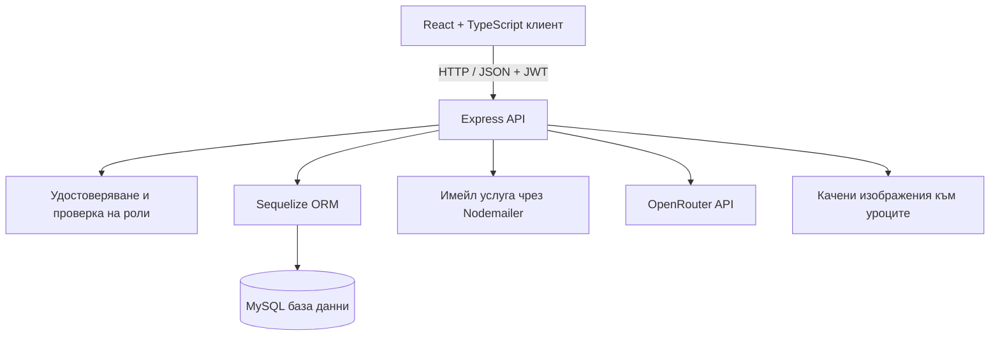

<div align="center">

# 🎓 EduVision

### По-интелигентна учебна среда за ученици, учители и училищни администратори.

EduVision е образователна платформа, която обединява учебни материали, организация на класове и стаи, управление на потребителски профили и AI асистент, запознат със съдържанието на конкретния урок.

[](LICENSE)


[Общ преглед](#-общ-преглед) · [Функционалности](#-основни-функционалности) · [Технологии](#-използвани-технологии) · [Инсталация](#-инсталиране-и-стартиране) · [Конфигурация](#-конфигурация-на-средата) · [API](#-преглед-на-api)

</div>

---

## ✨ Общ преглед

EduVision е създаден, за да подпомага организирания учебен процес:

- **Учителите** организират учебните занятия в стаи и публикуват уроци с текстово съдържание, видеоклипове и допълнителни изображения.
- **Учениците** се присъединяват към стаи чрез код, преглеждат учебните материали и задават на AI асистента въпроси за конкретен урок.
- **Училищните администратори** управляват потребители и учебни пространства в рамките на своето училище.
- **Суперадминистраторите** разполагат с по-широк поглед и права за управление на платформата.

Приложението е разделено на frontend, изграден с React и TypeScript, и backend, разработен с Node.js и Express. Сървърът използва Sequelize за комуникация с MySQL, JWT за удостоверяване на потребителите, Nodemailer за потвърждаване на имейл адреси и възстановяване на пароли, както и OpenRouter за AI асистента, който отговаря на въпроси по учебния материал.

## 🚀 Основни функционалности

### 🔐 Регистрация и удостоверяване на потребителите

- Регистрация с име, имейл адрес, училище, парола и заявена потребителска роля.
- Потвърждаване на имейл адрес чрез шестцифрен код, който изтича след 15 минути.
- Паролите се хешират с `bcrypt`, преди да бъдат съхранени в базата данни.
- При успешно влизане се издава JSON Web Token (JWT) със срок на валидност седем дни.
- Процедури за забравена и повторно зададена парола чрез код, изпратен по имейл.
- Потвърждаване на промяна на имейл адрес при административни операции с потребителски профили.

### 🏫 Управление на класове и учебни стаи

- Учителите могат да създават стаи със заглавие и учебен предмет.
- Всяка стая получава уникален код за присъединяване.
- Учениците могат да се присъединяват към стая чрез нейния код и да виждат стаите, в които участват.
- Учителите управляват собствените си стаи, а администраторите разполагат с права за управление в рамките на съответното училище.
- Административните изгледи показват информация за стаите, включително учител, брой уроци и брой ученици.

### 📚 Управление на уроци и учебни материали

Всеки урок може да съдържа:

- Пореден номер и заглавие на урока.
- Текстово съдържание на учебния материал.
- Незадължителен URL адрес към видео, което може да се визуализира във вграден видеоплейър при поддържан формат.
- Незадължително изображение или инфографика към урока.

Уроците се показват по пореден номер в рамките на съответната стая. Учителите могат да променят заглавията на уроците, а администраторите имат по-широки права за редактиране според ролята и обхвата на училището.

### 🤖 AI асистент за конкретния урок

EduVision включва AI чат, чрез който учениците могат да задават въпроси за избрания урок. Backend-ът изпраща съдържанието на урока и въпроса на ученика към OpenRouter, използвайки модела `openai/gpt-4o-mini`. Инструкциите към модела го насочват да се придържа към темата на урока и да дава кратки и ясни отговори.

> Отговорите на AI се генерират от външна услуга. Те са помощно средство за учене и не заместват прегледа и проверката на оригиналния учебен материал.

### 🛡️ Администрация според потребителската роля

Backend-ът прилага проверки на ролите и правила за достъп, ограничени до съответното училище, за административните операции.

| Роля | Основни права |
| --- | --- |
| `student` | Присъединяване към стаи с код, достъп до стаи и уроци, към които е записан, и задаване на въпроси на AI асистента по съдържанието на урока. |
| `teacher` | Създаване и управление на собствени стаи, създаване на уроци и редактиране на заглавията на уроците в управляваните от него стаи. |
| `admin` | Управление на допустими учители и ученици в рамките на училището, както и преглед и управление на стаи и уроци в съответния училищен обхват. |
| `superadmin` | Преглед на потребители и стаи в цялата платформа и изпълнение на разширени административни операции. Някои операции със стаи остават само за преглед. |

Административните права се проверяват чрез middleware и проверки в сървърните маршрути, а не само чрез елементите, показвани във frontend интерфейса.

## 🧰 Използвани технологии

| Област | Технологии |
| --- | --- |
| Frontend | React 19, TypeScript, Vite, React Router, Axios |
| Backend | Node.js, Express 5 |
| База данни и ORM | MySQL, `mysql2`, Sequelize |
| Удостоверяване | JSON Web Token (`jsonwebtoken`), `bcrypt` |
| Имейл услуги | Nodemailer с Gmail SMTP и конфигурация чрез App Password |
| Изкуствен интелект | OpenRouter Chat Completions API с модела `openai/gpt-4o-mini` |
| Обработка на файлове | Обработка на изображения в Base64 и статично обслужване на файлове от `/uploads`; `Multer` е посочен сред backend зависимостите |
| Разработка | Vite, TypeScript, Nodemon |

## 🏗️ Архитектура на приложението



Frontend-ът използва Axios за изпращане на заявки към API. Когато в браузърния `localStorage` има токен, Axios клиентът го добавя към заявките като `Bearer` authorization header. На сървъра middleware-ът за удостоверяване проверява токена и зарежда текущия потребител, преди да разреши изпълнението на защитени операции.

## 📁 Структура на проекта

```text
EduVision/
├── client/
│   ├── src/
│   │   ├── api/
│   │   │   └── api.ts                 # Общ Axios клиент и JWT header
│   │   ├── pages/
│   │   │   ├── Login.tsx              # Екран за вход
│   │   │   ├── Register.tsx           # Екран за регистрация
│   │   │   ├── VerifyEmail.tsx        # Потвърждаване на имейл
│   │   │   ├── Forgotpassword.tsx     # Заявка за възстановяване на парола
│   │   │   ├── Resetpassword.tsx      # Задаване на нова парола
│   │   │   ├── Room.tsx               # Учебни стаи
│   │   │   ├── Lesson.tsx             # Преглед на урок
│   │   │   └── AdminPanel.tsx         # Административен панел
│   │   ├── App.tsx                    # Маршрути на frontend приложението
│   │   ├── main.tsx                   # Начална точка на React приложението
│   │   └── index.css                  # Глобални стилове
│   ├── package.json
│   └── package-lock.json
├── server/
│   ├── config/
│   │   └── database.js                # Връзка между Sequelize и MySQL
│   ├── middleware/
│   │   ├── authMiddleware.js          # JWT удостоверяване
│   │   └── roleMiddleware.js          # Проверка на разрешените роли
│   ├── models/                        # Модели на данните в Sequelize
│   ├── routes/
│   │   ├── authRoutes.js              # Регистрация и удостоверяване
│   │   ├── roomRoutes.js              # Маршрути за учебните стаи
│   │   ├── lessonRoutes.js            # Маршрути за уроците
│   │   ├── aiRoutes.js                # Маршрути за AI асистента
│   │   └── adminRoutes.js             # Административни маршрути
│   ├── utils/                         # Помощни функции за имейли, кодове и достъп
│   ├── uploads/                       # Папка за качените изображения към уроците
│   ├── server.js                      # Начална точка на Express сървъра
│   ├── package.json
│   └── package-lock.json
├── LICENSE
└── README.md
```

## ✅ Инсталиране и стартиране

### Необходими компоненти

Преди да стартирате проекта, инсталирайте и подгответе:

- **Node.js 22.12+** (или Node.js 20.19+) и npm. Тези версии съответстват на изискванията на използваната версия на Vite.
- **MySQL**, работещ локално или на достъпен сървър за бази данни.
- **Gmail акаунт с Google App Password** за изпращане на имейли за потвърждение и възстановяване на парола.
- **OpenRouter API ключ** за заявките към AI асистента.

### 1. Клониране на repository-то

```bash
git clone https://github.com/VeselinSv/EduVision.git
cd EduVision
```

### 2. Създаване на базата данни

Създайте MySQL база данни за EduVision. Например:

```sql
CREATE DATABASE eduvision CHARACTER SET utf8mb4 COLLATE utf8mb4_unicode_ci;
```

Връзката към базата данни се конфигурира чрез променливите на средата във файла `server/.env`. При стартиране сървърът извиква Sequelize `sync({ alter: true })`, за да синхронизира моделите с базата данни. Използвайте отделна тестова база за разработка, когато променяте схемата, и въведете изрични миграции преди внедряване в продукционна среда.

### 3. Конфигуриране и стартиране на backend-а

Създайте файл `server/.env` и добавете стойностите, описани в раздела [Конфигурация на средата](#-конфигурация-на-средата).

Инсталирайте зависимостите на backend-а:

```bash
cd server
npm install
```

Стартирайте сървъра в режим за разработка:

```bash
npm run dev
```

Или го стартирайте без Nodemon:

```bash
npm start
```

Express приложението слуша на порта, зададен чрез `PORT`. Основният endpoint (`/`) връща `API is running...`, когато сървърът работи и успешно се е свързал с базата данни.

### 4. Конфигуриране и стартиране на frontend-а

Отворете **втори терминал** в основната директория на проекта и изпълнете:

```bash
cd client
npm install
npm run dev
```

Vite ще покаже в терминала локалния адрес на приложението (обикновено `http://localhost:5173`). Отворете този адрес в браузър.

За създаване и преглед на production build:

```bash
cd client
npm run build
npm run preview
```

> **Настройка за локална разработка:** Axios клиентът в `client/src/api/api.ts` в момента използва адреса `http://localhost:5000/api`. Страницата на урока също използва `http://localhost:5000`, когато зарежда качени файлове. При внедряване на различен сървър или домейн актуализирайте тези адреси.

## 🔧 Конфигурация на средата

В repository-то няма включен `.env` файл с реални стойности. Създайте `server/.env` локално и попълнете следните променливи:

```dotenv
# Сървър
PORT=5000
JWT_SECRET=replace_with_a_long_random_secret

# MySQL
DB_HOST=localhost
DB_NAME=eduvision
DB_USER=your_mysql_user
DB_PASSWORD=your_mysql_password

# Gmail SMTP — използвайте Google App Password, а не обичайната парола за акаунта
GMAIL_USER=your-address@gmail.com
GMAIL_APP_PASSWORD=your_16_character_app_password

# OpenRouter — използва се от AI асистента за уроците
OPENROUTER_API_KEY=your_openrouter_api_key
```

| Променлива | Предназначение |
| --- | --- |
| `PORT` | Портът, на който работи Express сървърът. |
| `JWT_SECRET` | Секретен ключ за подписване и проверка на токените за вход. Пазете го в тайна и използвайте дълга, случайно генерирана стойност. |
| `DB_HOST` | Име на хоста или IP адрес на MySQL сървъра. |
| `DB_NAME` | Името на базата данни на EduVision. |
| `DB_USER` | Потребителското име за MySQL. |
| `DB_PASSWORD` | Паролата на MySQL потребителя. |
| `GMAIL_USER` | Gmail адресът, от който се изпращат имейлите за потвърждение и възстановяване. |
| `GMAIL_APP_PASSWORD` | Google App Password, използвана от Nodemailer за удостоверяване пред Gmail. |
| `OPENROUTER_API_KEY` | API ключът за изпращане на заявки към OpenRouter. |

Не добавяйте `server/.env` към системата за контрол на версиите. Не поставяйте backend тайни във frontend кода и не използвайте публичен или споделен JWT секрет в реална продукционна среда.

## 🧭 Маршрути във frontend приложението

| Път | Страница | Предназначение |
| --- | --- | --- |
| `/` | Вход | Влизане в съществуващ потребителски профил. |
| `/register` | Регистрация | Създаване на профил и започване на потвърждаването по имейл. |
| `/verify-email` | Потвърждаване на имейл | Потвърждаване на регистрацията чрез получения код. |
| `/forgot-password` | Забравена парола | Заявка за код за възстановяване на паролата. |
| `/reset-password` | Нова парола | Задаване на нова парола след проверка на кода. |
| `/room` | Учебни стаи | Преглед на стаите, създаване на стая при наличие на права или присъединяване чрез код. |
| `/lesson` | Работно пространство за урок | Преглед на съдържанието, свързано видео или изображение и AI чат. |
| `/admin` | Административен панел | Управление на потребители и преглед на стаи според потребителската роля. |

## 🔌 Преглед на API

Всички API маршрути по-долу използват префикса `/api`, с изключение на основния endpoint за проверка на състоянието и пътя за качените медийни файлове.

### Удостоверяване — `/api/auth`

| Метод | Endpoint | Предназначение |
| --- | --- | --- |
| `POST` | `/register` | Започва регистрация и изпраща код за потвърждение по имейл. |
| `POST` | `/verify-email` | Проверява кода и създава потребителския профил. |
| `POST` | `/resend-code` | Изпраща нов код за потвърждение на регистрацията. |
| `POST` | `/login` | Проверява данните за вход и връща JWT. |
| `GET` | `/admin-slots` | Връща броя на наличните места за публична регистрация на администратори. |
| `POST` | `/forgot-password` | Заявява код за възстановяване на паролата. |
| `POST` | `/reset-password` | Проверява кода за възстановяване и актуализира паролата. |

### Учебни стаи — `/api/rooms`

| Метод | Endpoint | Предназначение |
| --- | --- | --- |
| `GET` | `/my` | Връща стаите, до които удостовереният потребител има достъп. |
| `POST` | `/create` | Създава стая (за роля `teacher`). |
| `POST` | `/join` | Присъединява ученик към стая чрез код (за роля `student`). |
| `PUT` | `/:id` | Актуализира стая според ролята и правилата за собственост. |
| `DELETE` | `/:id` | Изтрива стая според ролята и ограниченията за съответното училище. |

### Уроци — `/api/lessons`

| Метод | Endpoint | Предназначение |
| --- | --- | --- |
| `POST` | `/create` | Създава урок с текст и незадължителни медийни файлове. |
| `GET` | `/room/:roomId` | Връща уроците в дадена стая, подредени по номер. |
| `PUT` | `/:id` | Актуализира полетата на урока, разрешени за текущата роля. |
| `DELETE` | `/:id` | Изтрива урок при спазване на правилата за достъп. |

### AI и администрация

| Метод | Endpoint | Предназначение |
| --- | --- | --- |
| `POST` | `/api/ai/ask` | Изпраща въпрос за конкретен урок; изисква удостоверяване. |
| `GET` | `/api/admin/users` | Връща списък с потребители, видими за администратор или суперадминистратор. |
| `GET` | `/api/admin/rooms` | Връща списък със стаи, видими за администратор или суперадминистратор. |

Защитените заявки трябва да съдържат следния HTTP header:

```http
Authorization: Bearer <your_jwt_token>
```

Общият Axios клиент във frontend приложението добавя този header автоматично, когато в `localStorage` има стойност за `token`.

## 🔒 Сигурност и внедряване

- Използвайте HTTPS в продукционна среда и ограничете CORS до разрешените frontend адреси. В текущата конфигурация на Express CORS е разрешен без списък с позволени източници.
- Съхранявайте всички пароли, ключове и други тайни в променливи на средата. Никога не добавяйте `.env` файлове или продукционни тайни в repository-то.
- Прегледайте стратегията за миграции и архивиране на базата данни преди внедряване. Използваното при стартиране `sequelize.sync({ alter: true })` е удобно за разработка, но не замества контролиран процес за миграции.
- Настройте базовия URL за API и медийните файлове според адреса на backend сървъра; в текущия frontend код има адреси към `localhost`.
- Проверете правилата за достъп с отделни тестови профили за ученик, учител, администратор и суперадминистратор преди публикуване.
- AI заявките изпращат съдържанието на избрания урок и въпроса на потребителя към OpenRouter. Не добавяйте чувствителни лични данни в учебните материали, освен ако организацията ви не е одобрила този поток от данни.

## ⚠️ Важна бележка за стартирането

При преглед на source кода в `server/routes/authRoutes.js` беше открит импорт към `../config/socket`. В публикувания `main` branch не успях да намеря `server/config/socket.js` или `server/config/socket/index.js`. Ако този модул липсва и във вашето локално копие, Node.js ще прекрати зареждането на маршрутите за удостоверяване с грешка `MODULE_NOT_FOUND`. Преди стартиране на backend-а възстановете предвидения модул (включително експорта `emitUsersChanged`) или коригирайте импорта и местата, на които се използва.

## 🛠️ Отстраняване на проблеми

**Сървърът се затваря при стартиране**

Проверете дали MySQL работи, дали базата данни е създадена и дали `server/.env` съдържа валидни настройки за базата данни, `PORT` и `JWT_SECRET`. Уверете се също, че всички импортирани backend модули съществуват в изтегленото repository.

**Имейлите за регистрация или възстановяване на парола не се изпращат**

Проверете стойностите на `GMAIL_USER` и `GMAIL_APP_PASSWORD`. Gmail SMTP обикновено изисква Google App Password и активирана двуетапна проверка. Обикновената парола за Gmail акаунта няма да работи.

**AI чатът връща грешка**

Проверете `OPENROUTER_API_KEY`, достъпа до мрежата и логовете на сървъра за отговор от външната услуга. OpenRouter трябва да е достъпен, за да върне `/api/ai/ask` отговор.

**Frontend приложението не може да се свърже с backend-а**

Проверете дали backend-ът работи на порт `5000` или актуализирайте фиксирания във frontend адрес според `PORT`. Проверете също за несъответствие в URL адреса или CORS настройките, което може да блокира заявката в браузъра.

## 🤝 Принос към проекта

Приноси, сигнали за грешки и предложения за подобрения са добре дошли. Преди да отворите pull request, опишете проблема, който решавате, ограничете промените до необходимото и включете ясни стъпки за възпроизвеждане на грешките. При промени в потребителските роли или удостоверяването опишете последиците за сигурността и тествайте достъпа за съответните роли.

## 📄 Лиценз

EduVision се разпространява под лиценза [MIT](LICENSE).

---

<div align="center">

**EduVision — обединява организацията на учебния процес и ученето с подкрепата на изкуствен интелект.**

</div>
